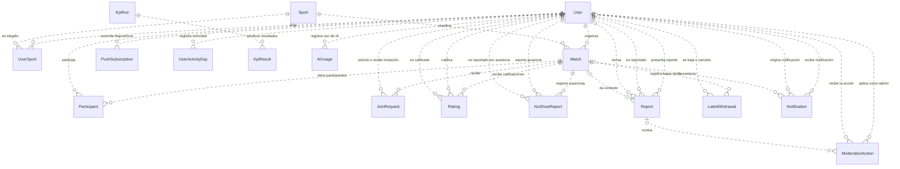

# Modelo de datos

PostgreSQL guarda los datos de Sportmatch. El [esquema de Prisma](../back/prisma/schema.prisma) es la fuente de verdad para campos, índices y restricciones. El diagrama muestra sus 17 modelos y sus relaciones; las etiquetas distinguen los roles cuando un modelo apunta más de una vez a `User`.

Cada relación indica cuántos registros pueden existir de cada lado. Por ejemplo, un partido tiene un organizador y un usuario puede organizar cero o más partidos. Un reporte puede no estar asociado a un partido.

## Reglas principales

- **Cupo.** `Match.capacity` incluye al organizador, que se guarda en `Match.organizerId`. Los demás jugadores confirmados son filas de `Participant`. Una solicitud o invitación pendiente no ocupa lugar. La aceptación bloquea la fila del partido y vuelve a comprobar el cupo dentro de la transacción antes de agregar al participante. La edición tampoco permite bajar el cupo por debajo de los confirmados. Ver [conteo](../back/src/utils/matches/player-count.ts), [aceptación](../back/src/join-requests/join-requests.repository.ts) y [edición](../back/src/matches/matches.repository.ts).
- **Solicitudes e invitaciones.** `JoinRequest` tiene una sola fila por par partido/usuario. El origen distingue `REQUEST` (solicita el jugador, responde el organizador) de `INVITATION` (invita el organizador, responde el invitado). Sus estados son `PENDING`, `ACCEPTED` y `REJECTED`. Aceptar agrega al jugador como participante. Ver [servicio de solicitudes](../back/src/join-requests/join-requests.service.ts).
- **Puntaje.** Se promedian las calificaciones válidas, un 1 por falta confirmada y un 2 por baja o cancelación tardía (menos de dos horas antes del partido). Se excluye una calificación si quien la dio o quien la recibió tiene una falta confirmada en ese partido. El resultado se redondea a un decimal y es `null` si no hay valores; `ratingCount` cuenta únicamente las calificaciones válidas. Ver [cálculo del puntaje](../back/src/users/users.service.ts) y [regla de baja tardía](../back/src/utils/matches/late-withdrawal.ts).
- **Suspensión por faltas.** Una falta se confirma con el reporte del organizador o con dos reportantes distintos. Tres faltas confirmadas en una ventana de 90 días disparan una suspensión de siete días; si vuelve a alcanzar el umbral dentro de los 12 meses desde el inicio de la última suspensión, dura seis meses. Las bajas tardías afectan el puntaje, pero no cuentan como faltas confirmadas. Las acciones administrativas se registran por separado en `ModerationAction`. Ver [confirmación de faltas](../back/src/utils/ratings/confirmed-no-shows.ts) y [suspensiones](../back/src/utils/no-shows/suspension.ts).
  Mientras la suspensión esté vigente, el usuario no puede crear partidos, solicitar ingreso ni aceptar invitaciones.
